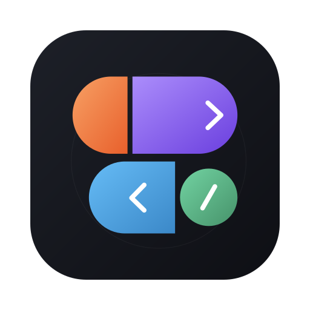

# figmake-sync



Edit your Figma Make project with your own AI, then send it back.

[Download for Mac or Windows](https://github.com/sherlabs/figmake-sync/releases/latest)

1. Paste your Figma Make link and press Open.
2. Describe a change. Your preview updates as the AI works.
3. Press Send to Figma.

First run asks once: sign in to Figma, and pick Claude or ChatGPT. Everything else (Node, the AI tool, installing, running the app, backups) happens by itself. Projects are created for you inside `~/figmake-sync` (not Documents, which iCloud/OneDrive may sync and slow right down); Settings can move that workspace for new projects.

Good to know:

- Not an official Figma integration; it drives Figma in a browser window that keeps your own sign-in.
- Undo and every run are backed up first; if Figma has newer changes at send time, you choose Keep mine or Use Figma's.
- The AI can only edit files in the project folder; it cannot see the Figma canvas. ChatGPT (Codex) support is untested against a real account.
- This is not a sandbox: the project's own code runs on your computer, so use projects you trust.

## How the AI is run

The app runs the Claude Code or Codex command-line tool on your own sign-in (it never sees your login or API keys and strips key-style environment variables). If the tool is missing it is installed privately under `<app data>/runtime/tools-agents` (never `-g`). Claude Code runs non-interactively with a short tool allowlist and no bypass flag; Codex runs with `--sandbox workspace-write`. Each prompt gets a short fixed preface, and the app never writes helper files such as `CLAUDE.md` into your project. Runs time out after 30 minutes, can be stopped with Esc, and the preview only ever shows the project's own local dev server.

### Private Node.js runtime (optional)

Running your project needs Node.js and npm. If they are not on your computer, the app installs a private copy for itself automatically. It is an isolated app-managed folder, not an OS sandbox.

- **What is downloaded:** the current Node.js LTS from `nodejs.org/dist` (about 50 MB), then pnpm from the npm registry into the same folder (about 50 MB). About 270 MB on disk.
- **Verification:** the Node.js archive is checked against nodejs.org's published `SHASUMS256.txt` (SHA-256) before anything is unpacked. On a mismatch it is discarded and nothing is installed. Archives are unpacked with path-traversal and symlink-escape checks. pnpm is installed by npm, which verifies the registry's package integrity; it is not pinned or independently checksummed by figmake-sync.
- **Where it lives:** `<app data>/runtime/node-v<version>/` only (on macOS `~/Library/Application Support/figmake-sync/runtime`). No admin rights, no changes to your PATH, shell profile or global npm settings, and the npm cache for the install is inside that folder and removed afterwards.
- **When it is used:** only if a working system Node/npm is not found. Your own installs always win. The private copy is added to the PATH of the processes figmake-sync starts (npm install, the dev server, the agent), never to the app's own environment.
- **Remove it:** delete that `runtime` folder. A half-finished install is never used (a `.complete` marker is written last).
- **No internet, or a proxy that blocks it?** Install Node.js yourself from nodejs.org; the app will pick it up.

## The Problem

Teams using Figma Make often hit the same friction:

- A designer or prototyper downloads generated code as a ZIP.
- They make local edits in VS Code or hand files to an engineer.
- They want those edits reflected back in Make so the prototype stays usable.
- They also want to pull new Make output back down without losing local work.

Today, that process is mostly manual.

- Downloading is manual.
- Uploading new files is manual.
- Updating existing files is manual.
- Checking drift between local and remote is manual.
- Deletions and renames are risky.

That slows iteration down and creates uncertainty:

- Which version is the latest one?
- Did Make and local code drift?
- If I upload these files, what else changed?
- Can I safely hand this off to engineering?

## Why We Built It

We built `figmake-sync` to give Figma Make users a practical local-first workflow without pretending an official write API exists when it does not.

The goal is not to replace Figma Make.

The goal is to make Figma Make usable inside a real design-to-code workflow:

- designers can keep using Make as a fast prototyping surface
- engineers can work from a normal local project folder
- teams can track exactly what changed
- nobody has to juggle ZIP files and drag-drop uploads by memory

This is especially useful when a prototype starts crossing the line from “generated demo” into “something the team actually needs to maintain.”

## Why This Helps UX Designers

UX designers are often the first people to feel this pain because they sit right at the boundary between concept, prototype, and implementation.

`figmake-sync` helps by making that boundary less fragile:

- Designers can keep working in Figma Make without losing the benefits of a local code workspace.
- Visual tweaks and code fixes no longer require a messy re-import ritual every time.
- The desktop app makes common sync actions accessible without asking designers to live in the terminal.
- Local status and verification make it easier to know whether the prototype still matches what is in Make.
- Safer backups and confirmations reduce the fear of “one wrong click broke the prototype.”
- Teams get a cleaner handoff path from designer-owned prototype to engineer-owned codebase.

In short: it reduces prototype drift, lowers coordination overhead, and lets UX designers stay closer to the real implementation without taking on unnecessary tooling pain.

## How It Works

`figmake-sync` is local-first.

That means the working project is a normal local folder on your machine, and the app keeps hidden sync state in `.figmake-sync/`.

### Local State

The app stores:

- linked Figma Make URL
- project config
- last pulled snapshot manifest
- file hashes
- sync metadata
- logs
- downloaded ZIPs
- backups
- browser session profile

Everything stays local to your machine.

### Authentication

`figmake-sync` does not log in on your behalf.

Instead:

1. It launches a persistent local browser context with Playwright.
2. You log in manually to Figma Make.
3. Your session is reused locally on your machine for later sync actions.

This keeps the tool aligned with normal authentication and security boundaries.

### Pull

When you pull from Figma Make, the tool:

1. Opens the linked Make URL.
2. Navigates to the code area.
3. Downloads the latest code ZIP.
4. Extracts it into a temp workspace.
5. Compares it with local state.
6. Applies a safe strategy such as backup, merge, or abort.
7. Updates the local manifest and snapshot baseline.

### Status

When you check status, the tool compares your current local folder against the last pulled snapshot and reports:

- added files
- modified files
- deleted files
- renamed files when they can be detected conservatively

### Push

When you push local changes back to Figma Make, the tool:

- replaces contents of modified files through editor automation
- uploads new files or folders through the UI where possible
- optionally posts a contextual prompt after upload
- treats renames as add plus delete unless a safer path exists
- asks for confirmation before destructive actions
- leaves ambiguous deletions unresolved instead of guessing

### Verify

Verification is intentionally separate from push.

The tool re-downloads the remote code to a temporary directory and compares it against local files so you can answer a simple but important question:

“Does Figma Make still match what I think it matches?”

## Desktop App

One window: paste a link, describe changes, send. The preview of your running app is shown inside the window. Settings (the gear, or Cmd-,) has three rows: Claude or ChatGPT, the Workspace folder, and Sign out of Figma. Keyboard: Enter sends a prompt, Esc stops, Cmd-N opens another link.

### Updates

The installed app checks for a newer release shortly after it opens and every 6 hours, and downloads it quietly in the background. When one is ready, a single "Restart to update" button appears; otherwise it installs the next time you quit. Nothing is checked or restarted while a sync, pull, push or agent run is in progress, and failures are only written to the log.

- **What is checked:** the public GitHub releases of `sherlabs/figmake-sync` over HTTPS (`latest.yml` / `latest-mac.yml`). The downloaded file must match the SHA-512 in that metadata, and on macOS the update must carry a valid signature for the app. Pre-releases and older versions are never installed. No token or account is used, and no usage data is sent beyond the normal request to GitHub.
- **Turn it off:** set `FIGMAKE_DISABLE_UPDATES=1` in the environment, or set `updates.enabled` to `false` in the app settings (default `true`). Unpackaged/dev runs never check.

### Reporting a problem

When something fails, the message has a quiet **Report** button next to Try again. It opens a pre-filled new issue on GitHub in your browser; nothing is sent until you review it and press Submit, and the app uses no token or account. The issue contains only: the app version, your OS and CPU, the Electron version, the step that failed, a stable error code with the plain message, the last ~40 log lines, and which self-heal lookups were repaired or not (names only). Log lines are cleaned as they are written: Figma links and file ids, your home folder and other paths, usernames, emails, tokens and cookies, project names, query strings and anything you typed are removed. No code, file contents or prompts are included. If the report is too long for a link, the full text is copied to your clipboard to paste into the issue.

## CLI

The CLI still exists for scripting, debugging, and power users.

Available commands:

- `figmake-sync init <figma-make-url> [local-folder]`
- `figmake-sync auth`
- `figmake-sync pull`
- `figmake-sync status`
- `figmake-sync push`
- `figmake-sync verify`
- `figmake-sync sync-from-figma`

## Safety Principles

This project is intentionally conservative.

- Only operates on a Figma Make URL explicitly linked by the user.
- Only uses your own authenticated local browser session.
- Never stores your Figma password.
- Never attempts MFA bypass, captcha bypass, or credential scraping.
- Never operates on unrelated tabs.
- Never exfiltrates code, cookies, or session data.
- Everything runs locally.
- Supports dry-run mode.
- Uses bounded retries and backoff.
- Captures screenshots and traces on browser failures.
- Prompts before destructive actions.
- Fails safely when the UI is ambiguous.

## Installation

### Requirements

- macOS first
- Node.js 20+
- npm

### Setup

```bash
npm install
npx playwright install chromium
npm run build
```

### Launch The Desktop App

```bash
npm run app
```

## Releasing Installers

The repository includes a tag-driven GitHub Actions workflow at
[.github/workflows/release.yml](./.github/workflows/release.yml).

When you push a tag like `v0.1.0`, the workflow will:

- verify the tag matches the version in `package.json`
- build a macOS universal `.dmg` and `.zip`
- build a Windows x64 `.exe` installer with NSIS
- attach those artifacts to the matching GitHub Release

Packaging is defined in
[electron-builder.yml](./electron-builder.yml).

Example release flow:

```bash
npm version patch
git push origin main --follow-tags
```

If you prefer tagging manually:

```bash
git tag v0.1.0
git push origin v0.1.0
```

Important notes:

- macOS builds are signed and notarized if Apple signing secrets are configured (recommended for distribution).
- Windows builds are unsigned by default.
- Unsigned macOS builds can be run locally by right-clicking the app and selecting "Open" from the context menu.

### macOS Code Signing Setup

To enable signed and notarized macOS builds, add these secrets to your GitHub repository (Settings > Secrets and variables > Actions):

1. **CSC_LINK** - Base64-encoded .p12 certificate file (Developer ID Application certificate)
   ```bash
   base64 -i "YourCertificate.p12" | pbcopy
   ```

2. **CSC_KEY_PASSWORD** - Password for the .p12 certificate

3. **APPLE_ID** - Your Apple Developer account email address

4. **APPLE_APP_SPECIFIC_PASSWORD** - App-specific password from [appleid.apple.com](https://appleid.apple.com) (Security > App-Specific Passwords)

5. **APPLE_TEAM_ID** - Your Apple Developer Team ID (found in [developer.apple.com](https://developer.apple.com) under Membership)

If these secrets are not configured, the workflow will fall back to unsigned builds.

## Quick Start

### Desktop Workflow

1. Launch the app (`npm run app` from source).
2. Paste the Figma Make link and press Open.
3. Describe a change; press Send to Figma when you are happy.

### CLI Workflow

```bash
figmake-sync init https://www.figma.com/make/your-project /path/to/project
figmake-sync auth --project /path/to/project
figmake-sync pull --project /path/to/project
figmake-sync status --project /path/to/project
figmake-sync push --project /path/to/project
figmake-sync verify --project /path/to/project
```

## Local State Layout

```text
.figmake-sync/
├── artifacts/
├── backups/
├── browser-profile/
├── config.json
├── downloads/
├── file-hashes.json
├── last-pull-manifest.json
├── logs/
├── metadata.json
├── snapshots/
│   └── last-pull/
└── tmp/
```

## Architecture

The code is split so browser automation is replaceable later if Figma exposes an official write API.

- [src/core/service.ts](./src/core/service.ts): shared orchestration for init, auth, pull, status, push, verify, and safe sync
- [src/core/state.ts](./src/core/state.ts): local state store, backups, metadata, snapshots, and temp workspaces
- [src/diff/manifest.ts](./src/diff/manifest.ts): manifests, hashes, rename detection, and merge foundations
- [src/browser/session.ts](./src/browser/session.ts): Playwright persistent browser session lifecycle
- [src/figma/adapter.ts](./src/figma/adapter.ts): `FigmaMakeAdapter` interface and isolated selector-driven Playwright adapter
- [src/harness/](./src/harness): agent backend (Claude Code and Codex adapters, process runner, local dev server)
- [src/electron/main.ts](./src/electron/main.ts): desktop shell
- [src/electron/renderer/app.ts](./src/electron/renderer/app.ts): desktop UI
- [src/cli/index.ts](./src/cli/index.ts): optional CLI

## Notes On Selectors

Figma Make does not expose a stable public automation contract for these interactions.

Because of that:

- selectors are data, not code: [src/figma/selectors.default.json](./src/figma/selectors.default.json) holds an ordered selector list plus metadata (goal, kind, healable, expectTerms) for every key, validated with zod in [src/figma/selectors.ts](./src/figma/selectors.ts) and bundled into `dist` by `npm run build`
- optional hotfix without a release: drop a `selectors.local.json` (`{"version":1,"keys":{"codeModeButton":{"selectors":["..."]}}}`) in the app's data folder; its selectors are grammar-checked and tried before the built-in ones (it cannot change which keys are healable)
- layering, highest priority first: remembered self-heal fixes, `selectors.local.json`, the JSON defaults (config `selectorOverrides` still replaces a key's defaults)
- selector overrides are supported in config
- browser automation is designed to fail conservatively when the UI changes

### Self-healing when Figma changes its page

When Figma renames or moves a control, the app can repair that lookup on its own, with no extra screens. Every key marked `healable` in the selector JSON is covered: the Files/Code tab, the Files actions menu, Download code, Upload, Create file, Rename, the prompt box, Send, Stop, Save and quick-open. Delete and confirm-delete are never healed (the schema forbids it). It sends a small outline of the page's buttons, menus and inputs (labels and attribute names only: no code, file contents, typed text, URLs or cookies; emails and token-like strings are redacted) to the AI assistant you connected yourself (Claude Code or Codex) and nothing else: no telemetry, no figmake server. The assistant runs once, with no tools and read-only. Its answer is treated as untrusted: a suggested selector must pass a strict format check, match exactly one visible, enabled control whose own label contains an expected word for that key, have the right shape (menu items inside an open menu, inputs editable), and the step it belongs to must then really work (editor appears, menu opens, download starts, file chooser opens, name box appears, prompt retained and accepted) before it is remembered (in `selector-overrides.json` in the app's data folder). The Stop control is only observed, never clicked. Remembered fixes expire after 30 days or after repeated misses, and the app asks at most twice per key per session, with a one-hour cooldown after a failed attempt. The built-in selectors target the current Browser/Files tab layout (verified against live Figma Make; the Codex path has not been tested against a real Codex install, and Stop, Save and quick-open could not be exercised live). See [src/heal/index.ts](./src/heal/index.ts).

## Testing

```bash
npm test
npm run smoke
```

Current automated coverage includes:

- manifest and diff logic
- desktop app state persistence
- an end-to-end smoke flow using a fixture adapter instead of live Figma

## Project Structure

```text
.
├── README.md
├── examples/
├── scripts/
├── src/
│   ├── app/
│   ├── browser/
│   ├── cli/
│   ├── core/
│   ├── diff/
│   ├── electron/
│   ├── figma/
│   ├── harness/
│   ├── logging/
│   ├── types/
│   └── utils/
└── tests/
```

## Status

This is a macOS-first local desktop tool intended to make Figma Make workflows less manual and less fragile. It is not an official Figma integration, and the browser automation layer may need selector updates as the Figma Make UI changes.
